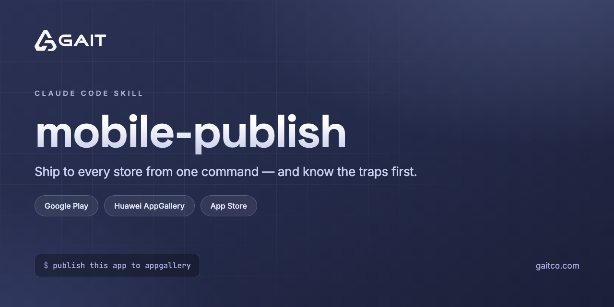

# mobile-publish



A [Claude Code](https://claude.com/claude-code) skill that builds and uploads a mobile app to
**Google Play**, **Huawei AppGallery**, or the **Apple App Store** — one command, no
per-project configuration.

Maintained by [GAIT](https://gaitco.com).

## Why

Every store release is the same four moves: produce a signed artifact, prove it is the *right*
signed artifact, push it to a holding area, and report the things only a human in the console
can do. What differs per store is the transport and the traps — and the traps are the reason
this exists.

Most of what is written here was measured against live apps rather than taken from
documentation, because the documentation is either missing or wrong on exactly the points that
cost hours.

## Install

```bash
git clone git@github.com:gaitco/mobile-publish.git ~/.claude/skills/mobile-publish
```

Claude Code picks it up automatically. Ask it to "publish this app to AppGallery" (or Play, or
TestFlight) from inside a Flutter, Android, or iOS repo.

Then set up store credentials once — see **[SETUP.md](SETUP.md)**. One credential per store
covers every app you publish, and any store you skip is simply skipped at publish time rather
than failing the run.

## What's in here

| File | Purpose |
|---|---|
| `SETUP.md` | One-time store credential setup for all three stores |
| `SKILL.md` | The shared workflow: establish the release, build, verify the signature, upload, verify it landed, report what no API can do |
| `references/appgallery.md` | Huawei AppGallery — auth, publishing, listing, and a long list of measured traps |
| `references/play.md` | Google Play via `fastlane supply` |
| `references/appstore.md` | Apple App Store |
| `references/appgallery-countries.txt` | The 198 country codes AppGallery actually accepts |
| `scripts/agc.py` | AppGallery Connect publishing CLI — python3 + curl + openssl, no gems or plugins |
| `scripts/publish.sh` | Store-agnostic entry point |
| `scripts/release-all.sh` | Batch uploads driven by `scripts/apps.tsv` |

## A sample of the traps it encodes

- **AppGallery returns HTTP 200 on logical failures.** The real status is in `.ret.code`, and a
  `ret.code 0` on a write proves only that the request parsed — unknown field names are dropped
  silently. Always read back.
- **`in_app_purchase` is a submission blocker on AppGallery.** It is Google Play Billing on
  Android, so on a Huawei device the paywall renders with no products — a visibly broken
  purchase flow, not graceful degradation.
- **AppGallery cannot distribute to the United States.** `US` is rejected outright, along with
  its territories.
- **One AppGallery error code means both "invalid country" and "list too long."** A binary
  search on list length converges on nonsense.
- **`flutter build apk --release` builds every flavor**, so one misconfigured flavor fails a
  build you didn't ask for.
- **Privacy tags, the AI declaration, content rating, compatible devices, and the app icon have
  no API surface at all** — verified across 30 endpoint paths and 14 field names, not assumed.

## Credentials

Never committed. Each store's mechanism is documented in its reference; credentials are read
from the macOS keychain, `~/.config/`, or the environment. One account-level credential covers
every app — if you find yourself creating a key per app, it was scoped too narrowly.

## License

MIT — see `LICENSE`.
