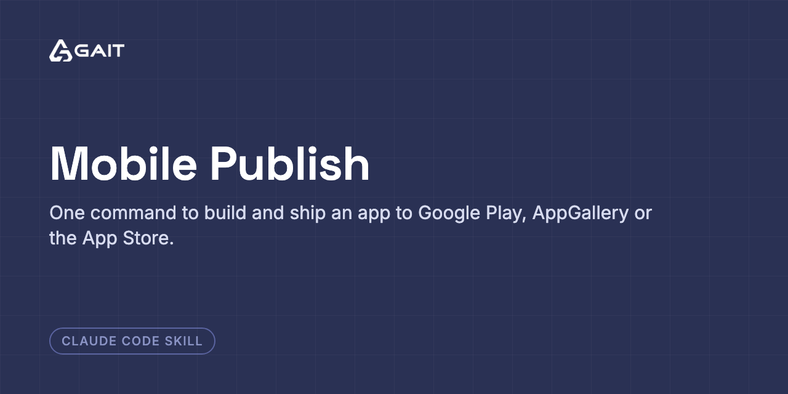

<p align="center"></p>

# mobile-publish


A shared skill for [Codex](https://developers.openai.com/codex/) and
[Claude Code](https://claude.com/claude-code) that builds and uploads a mobile app to
**Google Play**, **Huawei AppGallery**, or the **Apple App Store** — one command, no
per-project configuration.

Maintained by [GAIT](https://gaitco.com).

## Why

Every store release is the same four moves: produce a signed artifact, prove it is the *right*
signed artifact, push it to a holding area, and report the things only a human in the console
can do. What differs per store is the transport and the traps — and the traps are the reason
this exists.

Most of what is written here was measured against live apps rather than taken from
documentation, because the documentation is either missing or wrong on exactly the points that
cost hours.

## Install

### Codex

Install once per developer, for use across projects (requires GitHub repository access):

```bash
mkdir -p "$HOME/.agents/skills"
git clone git@github.com:gaitco/mobile-publish.git "$HOME/.agents/skills/mobile-publish"
```

Open the mobile app project in Codex and ask:

```text
Use $mobile-publish to build and upload this app to Google Play internal testing.
Do not submit it for review.
```

Or in Arabic:

```text
استخدم $mobile-publish لبناء التطبيق ورفعه على الاختبار الداخلي في Google Play، من غير إرساله للمراجعة.
```

Codex can also select the skill automatically for matching requests. It detects skill
changes automatically; restart Codex if the skill does not appear. See the
[official Codex skill documentation](https://learn.chatgpt.com/docs/build-skills).

If the skill is already installed at this path, update it instead of cloning again:

```bash
git -C "$HOME/.agents/skills/mobile-publish" pull --ff-only
```

Keep local edits on a branch; if updating fails, inspect the local changes rather than
resetting them. For a consistent company rollout, developers can check out an agreed
reviewed commit with `git checkout --detach <commit>` inside the skill clone.

### Claude Code

```bash
mkdir -p "$HOME/.claude/skills"
git clone git@github.com:gaitco/mobile-publish.git "$HOME/.claude/skills/mobile-publish"
```

Claude Code picks it up automatically. Ask it to "publish this app to AppGallery" (or Play,
or TestFlight) from inside the app project. Both agents use the same `SKILL.md` and scripts.

### Store access and local tooling

Set up store credentials once — see **[SETUP.md](SETUP.md)**. Installation does not grant
store permissions or install Flutter, Android SDK, fastlane, or Xcode. Use a local machine
with the required tools and account access; iOS builds require macOS and Xcode.
The convenience publisher discovers Flutter projects; for native Android/iOS projects,
use the project's existing build and release tooling with the store references.

Credentials remain outside this repository. Account-level credentials can serve multiple
apps when granted access to those apps. A skipped store is not a successful upload.
Uploading defaults to a holding state; review submission requires an explicit request.

### Run the helper directly

Keep the working directory inside the app project, not inside this skill's clone:

```bash
cd "/path/to/app project"
# Codex installation; use ~/.claude/skills/mobile-publish for a Claude-only installation.
MOBILE_PUBLISH_SKILL_DIR="$HOME/.agents/skills/mobile-publish"
bash "$MOBILE_PUBLISH_SKILL_DIR/scripts/publish.sh" --help
# Upload an already-built, verified artifact to Play only:
bash "$MOBILE_PUBLISH_SKILL_DIR/scripts/publish.sh" --store play
```

## What's in here

| File | Purpose |
|---|---|
| `SETUP.md` | One-time store credential setup for all three stores |
| `agents/openai.yaml` | Codex display metadata and invocation prompt |
| `SKILL.md` | The shared workflow: establish the release, build, verify the signature, upload, verify it landed, report what no API can do |
| `references/appgallery.md` | Huawei AppGallery — auth, publishing, listing, and a long list of measured traps |
| `references/play.md` | Google Play via `fastlane supply` |
| `references/appstore.md` | Apple App Store |
| `references/appgallery-countries.txt` | The 198 country codes AppGallery actually accepts |
| `scripts/agc.py` | AppGallery Connect publishing CLI — python3 + curl + openssl, no gems or plugins |
| `scripts/publish.sh` | Store-agnostic entry point |
| `scripts/release-all.sh` | Batch uploads driven by `scripts/apps.tsv` |

## A sample of the traps it encodes

- **AppGallery returns HTTP 200 on logical failures.** The real status is in `.ret.code`, and a
  `ret.code 0` on a write proves only that the request parsed — unknown field names are dropped
  silently. Always read back.
- **`in_app_purchase` is a submission blocker on AppGallery.** It is Google Play Billing on
  Android, so on a Huawei device the paywall renders with no products — a visibly broken
  purchase flow, not graceful degradation.
- **AppGallery cannot distribute to the United States.** `US` is rejected outright, along with
  its territories.
- **One AppGallery error code means both "invalid country" and "list too long."** A binary
  search on list length converges on nonsense.
- **`flutter build apk --release` builds every flavor**, so one misconfigured flavor fails a
  build you didn't ask for.
- **Privacy tags, the AI declaration, content rating, compatible devices, and the app icon have
  no API surface at all** — verified across 30 endpoint paths and 14 field names, not assumed.

## Credentials

Never committed. Each store's mechanism is documented in its reference; credentials are read
from the macOS keychain, `~/.config/`, or the environment. One account-level credential covers
every app — if you find yourself creating a key per app, it was scoped too narrowly.

## License

MIT — see `LICENSE`.
